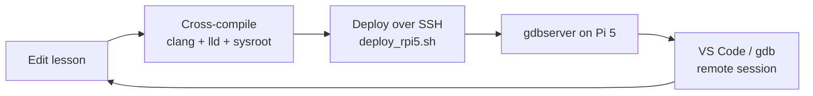

# CPP_Notes


-c51a4a.svg)


Modern C++ (C++20) study notes and examples, built as an embedded Linux workflow: every lesson is cross-compiled on a development machine, deployed to a Raspberry Pi 5 and debugged remotely with `gdbserver` from VS Code.

The notes follow a structured C++ course. The cross-compile / deploy / remote-debug setup is the same loop used for embedded Linux targets, so each example runs on real ARM64 hardware rather than only on the host.

## Workflow



| Step | How |
|---|---|
| Build | CMake + Ninja with [`cmake/toolchains/rpi5-aarch64.cmake`](cmake/toolchains/rpi5-aarch64.cmake): `clang --target=aarch64-linux-gnu`, `lld`, and a Raspberry Pi OS sysroot |
| Deploy | [`Scripts/deploy_rpi5.sh`](Scripts/deploy_rpi5.sh) packs the lesson binaries and streams them to the Pi over SSH (`tar` over `ssh`, no scp round trips) |
| Debug | [`Scripts/debug_rpi5.sh`](Scripts/debug_rpi5.sh) starts `gdbserver` on the Pi; the VS Code launch config attaches with the sysroot set, so library symbols resolve |
| Warnings | [`cmake/modules/common_warnings.cmake`](cmake/modules/common_warnings.cmake): `-Wall -Wextra -Wpedantic -Wshadow -Wconversion -Wsign-conversion` on every lesson |

## Repository layout

```
CPP_Notes/
├── CMakeLists.txt            # top level: C++20, compile_commands.json, warning module
├── cmake/
│   ├── modules/              # shared CMake helpers (warnings)
│   └── toolchains/           # Raspberry Pi 5 aarch64 toolchain file
├── Examples/
│   └── Lesson-NN/            # one self-contained target per lesson
│       ├── README.md         # topic notes for the lesson
│       └── src/
├── Scripts/                  # build, deploy and remote-debug helpers
├── Dockerfile                # Debian Bookworm cross-build image
└── .vscode/                  # tasks (build/deploy/gdbserver) and launch config
```

## Getting started

### Prerequisites

- CMake 3.20+, Ninja
- Clang and LLD (host cross-compiler)
- A Raspberry Pi OS (Bookworm, 64-bit) sysroot copied from the target
- SSH access to the Pi, with `gdbserver` installed on it
- For debugging: `gdb` with aarch64 support (or `gdb-multiarch`) and the VS Code C/C++ extension

### Build

```bash
cmake -S . -B build-rpi5 -G Ninja \
  -DCMAKE_TOOLCHAIN_FILE=cmake/toolchains/rpi5-aarch64.cmake
cmake --build build-rpi5
```

To build and run natively on the host instead, leave out the toolchain file:

```bash
cmake -S . -B build -G Ninja && cmake --build build
./build/Examples/Lesson-01/lesson_01
```

### Deploy and debug

```bash
./Scripts/deploy_rpi5.sh 1     # deploy Lesson-01 (or no argument for all lessons)
./Scripts/debug_rpi5.sh 1      # start gdbserver for Lesson-01 on the Pi
```

Then run **RPI5 Debug Lesson** in VS Code. The `Prepare Debug` task builds, deploys and starts `gdbserver` before attaching.

Host name, user and sysroot path are set at the top of each script and in the toolchain file; adjust them for your setup.

## Lessons

| Lesson | Topic | Status |
|---|---|---|
| [01](Examples/Lesson-01) | Toolchain bring-up: first program, build/deploy/debug loop on the Pi | Done |
| 02+ | Course topics, added as I work through them | In progress |

## Adding a lesson

1. Create `Examples/Lesson-NN/` with `src/main.cpp` and a `CMakeLists.txt` that defines `lesson_NN` and calls `set_common_warnings(lesson_NN)`.
2. Add `add_subdirectory(Lesson-NN)` to `Examples/CMakeLists.txt`.
3. Build, then `./Scripts/deploy_rpi5.sh NN`.

## Disclaimer

These are personal notes and independently written code based on concepts learned during a C++ training. All examples are written by me and contain no original material from the training provider. If any content unintentionally infringes someone's rights, please contact me and it will be removed.

## License

MIT, see [LICENSE](LICENSE).

---

Author: [Ergün Cücük](https://www.linkedin.com/in/ecucuk/), embedded software engineer (C/C++, embedded Linux, Android Automotive).
